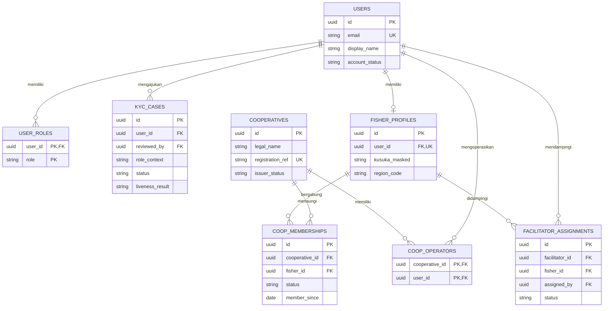
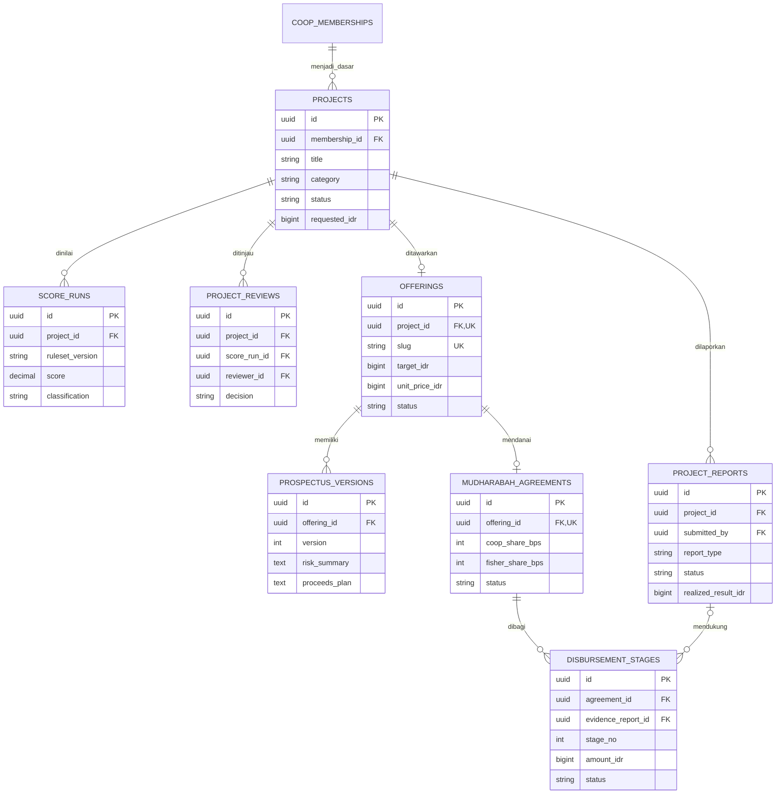
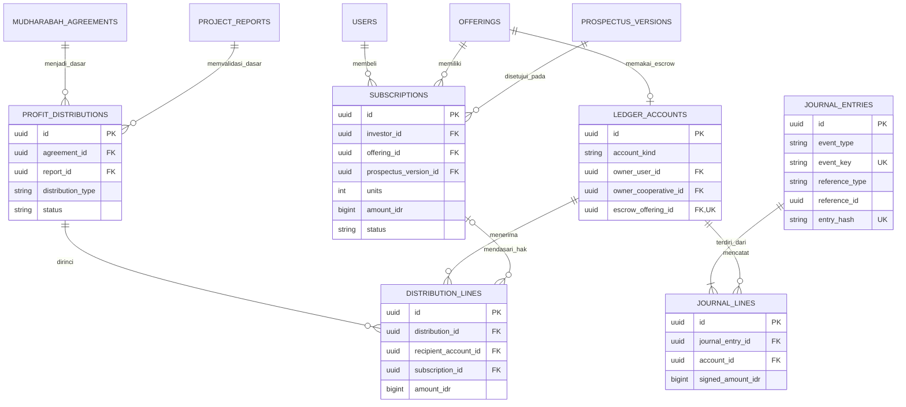

# ARTANAYA · Entity Relationship Diagram

**Versi 1.0 · Model relasional untuk MVP demonstrasi**

Diagram Mermaid dibagi menurut domain. Nama tabel yang muncul di lebih dari satu diagram merujuk ke tabel yang sama. `PK` adalah kunci utama, `FK` kunci asing, dan `UK` kunci unik. Daftar atribut pada diagram berfokus pada kunci dan atribut inti; rincian dan aturan lintas tabel mengikuti tiap diagram.

## A. Akun, koperasi, dan pendampingan

| Tabel | Atribut dan aturan pelengkap |
|---|---|
| `users`, `user_roles` | Tambahkan referensi autentikasi unik dan waktu penguncian akun. Peran mencakup INVESTOR, NELAYAN, OPERATOR_KOPERASI, FASILITATOR, ADMIN. |
| `kyc_cases` | Simpan waktu pengajuan dan keputusan, hasil MFA demo, alasan revisi dan admin pemeriksa. Pemeriksa kosong hingga ditugaskan. Satu kasus aktif per pengguna dan konteks peran. Dokumen tersimpan melalui `documents`. |
| `coop_memberships`, `coop_operators` | Batasi satu keanggotaan per pasangan koperasi–nelayan. Tugas operator berlaku hanya pada koperasi yang terhubung. |
| `facilitator_assignments`, `facilitator_notes` | `facilitator_notes(id PK, assignment_id FK, author_id FK, note, created_at)`. Satu penugasan aktif per pasangan; catatan hanya dapat diakses pihak yang ditugaskan, nelayan terkait, dan admin. |

## B. Pengajuan, penawaran, dan pelaksanaan usaha

| Tabel | Atribut dan aturan pelengkap |
|---|---|
| `projects` | Lokasi, rencana usaha, waktu pengajuan. `membership_id` menentukan nelayan dan koperasi; harus aktif saat pengajuan dan saat publikasi. |
| `score_runs` | Tambahkan `input_signals` (T/P/K/L/R dengan null bila kosong), bobot efektif, alasan, penanda nelayan baru, tanggal, dan referensi snapshot. `score` boleh kosong jika seluruh sinyal tidak tersedia. |
| `project_reviews` | Simpan alasan, tanggal, dan skor rujukan. Skor rujukan harus berasal dari proyek yang ditinjau. Reviewer adalah admin berwenang. |
| `offerings`, `prospectus_versions` | MVP memilih satu penawaran per proyek. Tambahkan jenis efek demo, periode buka/tutup, versi prospektus aktif dan akun escrow unik pada penawaran. `UNIQUE(offering_id, version)` pada prospektus. Versi yang sudah disetujui investor bersifat tetap. |
| `mudharabah_agreements` | Tambahkan versi dokumen, waktu aktif dan bukti persetujuan kedua pihak. Koperasi dan nelayan diturunkan dari penawaran dan keanggotaan proyek. Jumlah dua nisbah = 10.000 basis points. |
| `disbursement_stages` | Nomor tahap unik per akad. Simpan jadwal, persetujuan admin dan waktu pencairan. Total tahap maksimal dana yang masuk ke koperasi untuk penawaran terkait; laporan pendukung, bila dibutuhkan, harus valid dan terkait proyek yang sama. |
| `project_reports` | Periode, progres, penggunaan dana, hasil usaha bila relevan, bukti, admin validator dan alasan revisi. Hasil bertanda negatif diperbolehkan pada laporan realisasi untuk jalur tinjauan manual. |

## C. Pesanan, jurnal dana, dan distribusi

| Tabel | Atribut dan aturan pelengkap |
|---|---|
| `subscriptions` | Tambahkan waktu persetujuan, risiko disetujui dan kunci permintaan unik per investor. Versi prospektus harus terkait penawaran. Nominal = unit × harga unit pada saat pembelian; simpan snapshot harga. Portofolio diproyeksikan dari pesanan terkonfirmasi dan status penawaran. |
| `ledger_accounts` | Jenis `USER_WALLET`, `COOP_WALLET`, `OFFERING_ESCROW` dan `DEMO_CLEARING`. Terapkan tepat satu FK pemilik sesuai jenis, atau tanpa pemilik untuk clearing. Gunakan satu FK `escrow_offering_id` sebagai relasi fisik; properti akun escrow pada penawaran diperoleh dari relasi balik. |
| `journal_entries`, `journal_lines` | Setiap jurnal dana punya minimal dua baris, jumlah baris nol, nilai baris nonnol, kunci per kejadian bisnis unik, serta waktu dan aktor. Contoh kunci `purchase:<subscription_id>`, `refund:<subscription_id>`, `issuer_release:<offering_id>`, `stage:<stage_id>`. Referensi lintas jenis diperiksa layanan sebelum posting. |
| `profit_distributions` | Jenis `MUDHARABAH` untuk porsi koperasi–nelayan, dan `SECURITY_PAYOUT` untuk hak investor berdasarkan prospektus demo. Simpan periode, versi aturan, nilai laba yang divalidasi, dan referensi pembagian sebelumnya untuk payout investor. Unik per akad, periode, dan jenis. |
| `distribution_lines` | Baris investor terhubung ke pesanan penawaran yang sama. Jumlah payout investor dibatasi oleh dana yang dialokasikan untuk payout sesuai prospektus demo. Setiap distribusi yang dibayar menghasilkan satu jurnal unik; riwayat menampilkan dua jenis distribusi secara terpisah. |

Hitung saldo dari jurnal atau proyeksi yang diperbarui di dalam transaksi database yang sama. Untuk pembelian, kunci baris penawaran dan akun terkait, verifikasi status, waktu, saldo, dan sisa target, lalu buat pesanan, catat jurnal, dan perbarui status dalam satu transaksi. Terapkan pola serupa pada refund per pesanan, pencairan, dan distribusi. Untuk demo laba yang tersedia, alokasikan dana hasil usaha melalui akun clearing sebelum mendistribusikan ke dompet koperasi dan nelayan. Tetapkan metode pembulatan rupiah yang konsisten dan alokasikan sisa pembulatan deterministik. Hash jurnal hanya memuat data internal yang diperlukan untuk demonstrasi.

## D. Dokumen, keamanan, dan perluasan P1

| Tabel | Kunci dan atribut inti | Relasi |
|---|---|---|
| `documents` | `id PK, uploaded_by FK, storage_key UK, document_type, created_at`; FK konteks opsional | Tepat satu FK konteks aktif ke `kyc_cases`, `projects`, `prospectus_versions`, `mudharabah_agreements` atau `project_reports`. Otorisasi mengikuti konteks. |
| `security_alerts` | `id PK, subject_user_id FK, assigned_admin_id FK, alert_type, severity, status, resolution_note, created_at` | Satu pengguna memiliki banyak alert; admin penanggung jawab opsional. Lokasi dan liveness memakai sinyal fiktif. |
| `audit_events` | `id PK, actor_user_id FK, action, entity_type, entity_id, metadata_redacted, created_at` | Satu pengguna dapat memicu banyak audit; aktor kosong untuk proses sistem. Entity memakai referensi tipe/ID. Catatan ditambahkan tanpa perubahan retrospektif. |
| `articles` | `id PK, author_id FK, title, slug UK, body, status` | Pengguna berwenang dapat mengelola banyak artikel. |
| `forum_posts`, `forum_comments` (P1) | `id PK, author_id FK, body, moderation_status, created_at`; `post_id FK` pada komentar | Satu pengguna dapat membuat banyak posting/komentar. Satu posting dapat memiliki banyak komentar. |

**Indeks minimum:** antrean berdasarkan `(status, created_at)`; katalog berdasarkan `(status, closes_at)`; pesanan berdasarkan `(investor_id, created_at)` dan `(offering_id, status)`; jurnal berdasarkan `(account_id, journal_entry_id)` pada baris jurnal; penugasan berdasarkan `(facilitator_id, status)`; audit berdasarkan `(entity_type, entity_id, created_at)`. Simpan waktu dalam UTC dan tampilkan dengan lokal Indonesia sesuai konteks.
